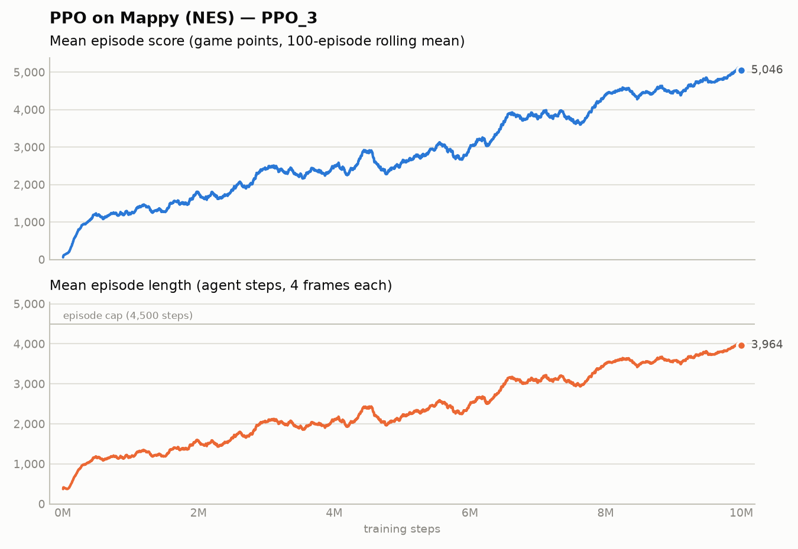

# Run 2026-09-01: PPO on Mappy pixels, sign-clipped reward, 10M steps

First full training run. **Outcome: the agent learned to farm the +10 trampoline-bounce
award and never collects an item or leaves round 1.** Details below; the fix is a reward
change, not more training.

## Setup

- Code: commit `ca15be8` (`scripts/train.py` defaults; hyperparameters unchanged since).
- Env (`mappy_env.py`): Discretizer (6 actions), StochasticFrameSkip(4, p=0.25),
  TimeLimit(4500 steps), WarpFrame 84x84 gray, Monitor, **ClipRewardEnv (sign clip)**;
  VecFrameStack(4). Reward = score delta (`scenario.json`); done = game-over banner with
  lives==3. Start state `integrations/Mappy-Nes/Level1.state`.
- PPO (SB3 2.9.0, CnnPolicy): lr 2.5e-4 with linear decay to 0, n_steps 128, batch 32,
  4 epochs, gamma 0.99, gae_lambda 0.95, clip 0.1, ent_coef 0.01, 8 SubprocVecEnv workers.
- Hardware: dev desktop, CPU only (96 cores available, 8 used), torch 2.13, python 3.12.
- Wall time: 17:44 -> 20:55 UTC (3h11m), ~870 fps steady state.
- Command: `python scripts/train.py > train.log` (10M steps, checkpoint every 100k).

## Training curve

- `rollout/ep_rew_mean` (raw game score; Monitor sits above the clipper): 57 -> 5,046, still rising at 10M.
- `rollout/ep_len_mean`: 371 -> 3,964 of the 4,500-step cap.
- Score is ~1.27 x length throughout: score is a function of survival time only.
- Entropy -1.79 -> -0.96; explained variance ~0.8 at the end; lr had decayed to ~0.

## Evaluation (2026-10-12)

| checkpoint | trained steps | policy | episodes | score mean ± sd | min / max | mean length (steps) | hit time cap | max round | items collected |
|---|---|---|---|---|---|---|---|---|---|
| `ppo_mappy_1000000_steps.zip` | 1M | sampled | 3 | 1,333 ± 482 | 760 / 1,940 | 1,271 | 0/3 | 1 | 0 |
| `ppo_mappy_2500000_steps.zip` | 2.5M | sampled | 3 | 2,517 ± 968 | 1,730 / 3,880 | 2,094 | 0/3 | 1 | 0 |
| `ppo_mappy_5000000_steps.zip` | 5M | sampled | 3 | 3,307 ± 720 | 2,720 / 4,320 | 2,735 | 0/3 | 1 | 0 |
| `ppo_mappy_7500000_steps.zip` | 7.5M | sampled | 3 | 3,287 ± 749 | 2,470 / 4,280 | 2,693 | 0/3 | 1 | 0 |
| `ppo_mappy_final.zip` | 10M | sampled | 5 | 5,088 ± 850 | 3,540 / 5,870 | 4,007 | 2/5 | 1 | 0 |
| `ppo_mappy_final.zip` | 10M | argmax | 3 | 5,933 ± 17 | 5,910 / 5,950 | 4,500 | 3/3 | 1 | 0 |

- Per-step score deltas in one final-checkpoint episode: **518 events, every one +10**
  (`eval/final_plus10_bounce_frames.png` shows a +10 landing mid-bounce). No 100+ item
  pickups at any checkpoint.
- Deaths per episode: 2-3 (trampoline wear or hurry-up cats), all within round 1.
- Action mix is spread across all six actions; the argmax policy survives the full
  5-minute cap every time.

## Why it happened

`ClipRewardEnv` maps every positive score delta to +1, so a +10 bounce equals a +500 item,
and `TimeLimit` truncation is free. Bouncing safely until the cap is the optimum under the
training reward. The brief anticipated this ("consider scaling instead").

## Next run should change

1. Reward: scale (`delta / 100`) or mask the +10 bounce award (reward only deltas >= 50);
   consider a small per-step cost so the time cap is not free.
2. Workers: `--num-envs 32` or more (96 cores here) to cut wall time.
3. Namespace outputs per run so `checkpoints/`, `tb_logs/` and `train.log` are not overwritten.

## Contents of this folder

| path | what | in git |
|---|---|---|
| `RUN.md` | this file | yes |
| `learning_curve.png` | score and length vs training steps | yes |
| `scalars.csv.gz` | all 12 tensorboard scalars, one row per update | yes |
| `eval/summary.md`, `eval/results.json`, `eval/eval_*.log` | evaluation table and per-episode detail | yes |
| `eval/media/*_frames.png`, `eval/final_plus10_bounce_frames.png` | frame strips | yes |
| `eval/media/*.mp4` | one full episode per checkpoint, real-time speed | no (local only, ~30 MB each) |
| `checkpoints/*.zip` | milestone models: 1M, 2.5M, 5M, 7.5M, final | no (local only, 21 MB each) |
| `tb_events/PPO_3/` | raw tensorboard run (`tensorboard --logdir <run>/tb_events`) | no (local only) |
| `train.log.gz` | full SB3 console log | no (local only) |

Reproduce the evaluation: `python scripts/evaluate.py <run>/checkpoints/*.zip --episodes 3 --media-dir out/`.
Re-plot: `python scripts/plot_curve.py <run>/tb_events/PPO_3 -o out/curve.png`.
